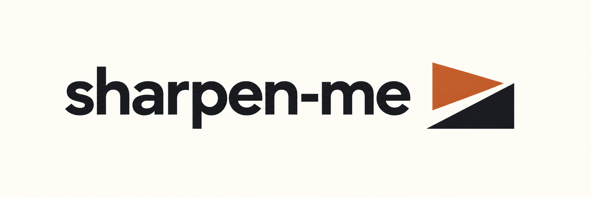

# sharpen-me

Codex와 Claude Code에서 요청을 구체화하고, 변경을 검토하고, 코드와 문서를 다듬는 8개 스킬입니다.

[](https://github.com/soom-kang/sharpen-me/actions/workflows/verify.yml)
[](../LICENSE)

[English](../README.md) · [사용법](usage.ko.md) · [GitHub Releases](https://github.com/soom-kang/sharpen-me/releases)

현재 릴리스는 [v0.9.0-beta.6](https://github.com/soom-kang/sharpen-me/releases/tag/v0.9.0-beta.6) GitHub Pre-release입니다. 릴리스와 설치 안내 문서를 갱신했습니다. 스킬 파일 24개는 beta.2, beta.3, beta.4, beta.5와 동일합니다.

현재 checkout에는 아직 릴리스되지 않은 개선이 포함되어 있습니다. [수정 범위와 검증 한계](evaluation.md#unreleased-skill-revisions-2026-10-26) (영문)를 확인하세요.

- 8개 스킬의 호출 경계와 종료 조건을 명확히 했습니다.
- `assess`의 추론 수준 선택 기준을 정리했습니다.
- `dedupe`의 동작 분류와 통합 action을 구분했습니다.
- beta.6 tag에는 이번 개선이 포함되어 있지 않습니다.
- 이번 수정본의 모델 평가 결과는 아직 없습니다.

## 전역 설치

Node.js 24.20.0 이상과 Git을 준비한 뒤 터미널에서 실행하세요.

```bash
npx skills add https://github.com/soom-kang/sharpen-me/tree/v0.9.0-beta.6 \
  --global --skill '*' --agent codex claude-code
```

설치 확인 단계에서 내용을 확인하고 진행하세요. 이 명령은 beta.6 tag의 스킬 8개를 사용자 전역 범위에 설치합니다. 같은 tag를 다시 사용하면 같은 릴리스를 설치하며, 업데이트하려면 새 tag를 선택해야 합니다. 재설치 전에 로컬 스킬 수정본을 보관하세요.

[사용법](usage.ko.md)에서 스킬 선택, 호출 예시, 업데이트와 제거 방법을 확인하세요.

## 평가 범위

beta.2의 선별 평가에서 후보 24개 슬롯이 모두 PASS였습니다. 이는 총 68회 호출의 유효한 결과를 모은 판정입니다. beta.6의 스킬 파일 24개는 beta.2, beta.3, beta.4, beta.5와 같으며, beta.3, beta.4, beta.5, beta.6에서 모델 평가를 새로 실행하지 않았습니다. 전체 576회 평가 게이트는 미통과 상태입니다. tag 설치는 소스 버전을 지정하는 방법이며, 새로운 모델 평가를 의미하지 않습니다.

[평가 근거와 한계](evaluation.md) · [설계](design.md) · [유지보수](maintenance.md) (영문) · [QA 보고서 (2026-10-12)](qa-2026-10-12.md)

MIT. [라이선스](../LICENSE).
