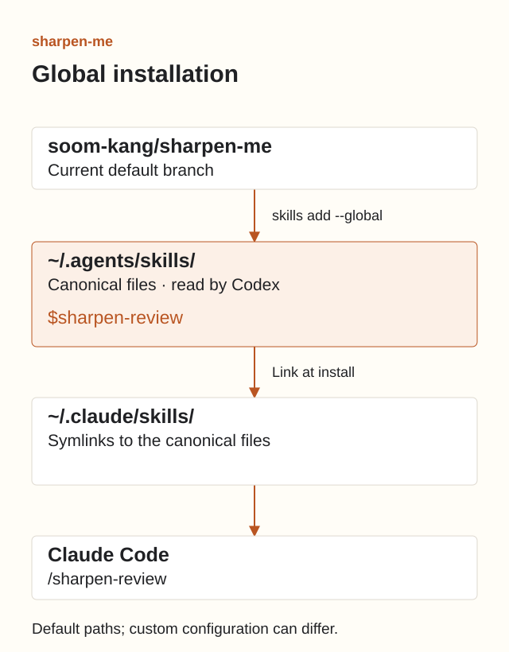
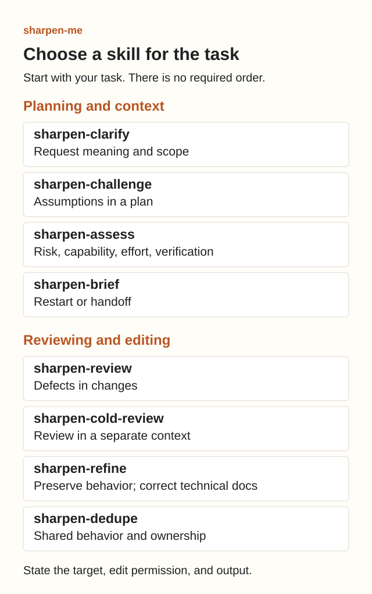

# Use sharpen-me

[한국어](usage.ko.md) · [Home](../README.md)

Choose a skill for the task and invoke it. The skills are independent choices, not a required sequence.

This guide describes beta.7's revised skill boundaries and stopping rules. A separate 32-call evaluation recorded 21 PASS and 11 UNCLEAR, including source-access gaps and two manually identified defects. See [results and limits](evaluation.md#beta7-focused-evaluation-2026-10-26).

## 1. Install and check

Have Node.js 24.20.0 or later, npm/npx, Git, and the Codex or Claude Code app you use available. You do not need a repository checkout.

### Install with npx

Install the [v0.9.0-beta.8 Pre-release](https://github.com/soom-kang/sharpen-me/releases/tag/v0.9.0-beta.8) from its tag:

```bash
npx skills add https://github.com/soom-kang/sharpen-me/tree/v0.9.0-beta.8 \
  --global --skill '*' --agent codex claude-code
npx skills list --global --agent codex claude-code
```

Confirm installation when prompted. You can decline the optional find-skills installation. Check that the list contains all eight sharpen-me skills. To install only one skill, run:

```bash
npx skills add https://github.com/soom-kang/sharpen-me/tree/v0.9.0-beta.8 \
  --global --skill sharpen-review --agent codex claude-code
```

Save local skill edits before reinstalling. Rerunning this tag URL installs the same release; choose a newer tag to receive a newer release. To use the current default branch instead, replace the tag URL with `soom-kang/sharpen-me`; that source can advance after a release. These user commands do not pin the skills CLI version.

The global list checks registered names, not the installed tag. See [Tag installation records](maintenance.md#tag-installation-records) to read the eight skills' recorded `ref` values without changing the installation.



The default symlink mode stores canonical files in `~/.agents/skills/` and links them from `~/.claude/skills/` for Claude Code. Codex uses the shared location. `CLAUDE_CONFIG_DIR` changes the Claude location. The CLI can fall back to copying if it cannot create a link.

## 2. Choose a skill



| Skill | Use it to | Stops when |
| --- | --- | --- |
| `sharpen-clarify` | Resolve what the request means | Interpretation is resolved or a consequential choice needs the user |
| `sharpen-challenge` | Test whether a plan's assumptions support its goal | Decision-relevant assumptions are resolved or their evidence gaps are clear |
| `sharpen-assess` | Choose capability, reasoning effort, and verification; assess risk separately | Advice or the evidence needed to give it is clear |
| `sharpen-brief` | Restore current state, blockers, and pending decisions | The requested delta or snapshot and its limits are understandable |
| `sharpen-review` | Find supported defects against contracts in a change or design | The bounded review is complete or material evidence is missing |
| `sharpen-cold-review` | Review comprehension or correctness in isolation | One review is complete, evidence is insufficient, or isolation is unavailable |
| `sharpen-refine` | Preserve code behavior or correct technical documentation from sources | The scoped improvement is verified, a no-op is justified, or a dependent edit is blocked |
| `sharpen-dedupe` | Decide which implementations can share behavior and ownership | The audit or authorized consolidation is complete within scope |

Choose between related requests by their question:

| Request | Choice |
| --- | --- |
| "What does an empty filter mean?" / "Will this index make the agreed filter faster?" | `clarify` for meaning; `challenge` for the performance premise |
| "Will this cache strategy work?" / "Does it violate the agreed invalidation contract?" | `challenge` for the mechanism; `review` for a concrete violation |
| "What capability, effort, and checks does this migration need?" | `assess`; a high-risk label alone does not select deeper reasoning |
| "Simplify this helper without changing behavior" / "Should these services share one parser?" | `refine` for settled ownership; `dedupe` for equivalence and ownership decisions |
| "What remains since revision B?" / "Did the test just run pass?" | `brief` for restored context; a direct answer for routine status |
| "Correct this documented command against the source" / "Only improve the grammar" | `refine` for technical accuracy; a writing skill such as `write-me` for language alone |

Use `sharpen-review` for ordinary change review and `sharpen-cold-review` when independence matters. Invoking `sharpen-cold-review` in the author conversation does not establish independence. It must report `not_run` if a separate context is unavailable.

Neighbor names are selection guidance, not prerequisites to load. A clarification-only request ends with interpretation; inside a larger authorized request, resolved clarification returns to that work. Refine preserves required behavior and intent, while correcting inaccurate documentation from sources. Dedupe defaults to an audit; sharing an owner is not authorized merely by proposing one.

## 3. Provide the task and its boundaries

Start with `$name` in Codex or `/name` in Claude Code. These are separate messages to the apps, not terminal commands.

```text
$sharpen-review Review the current diff for bugs. Do not edit files.
```

```text
/sharpen-review Review the current diff for bugs. Do not edit files.
```

Name the target, permitted edits, and desired output. Replace the example paths or commit with your own and send one request at a time. In Claude Code, replace the leading `$` with `/`.

<details>
<summary>Planning and handoff examples</summary>

```text
$sharpen-clarify Resolve the scope of the assignee filter from the API contract. Ask only about unresolved choices. Do not implement it.
$sharpen-challenge Examine the assumptions in docs/retry-plan.md. Propose a test that distinguishes support from rejection.
$sharpen-assess Assess the proposed migration's risk and verification needs. Recommend capability and reasoning effort. Do not execute it.
$sharpen-brief Summarize changes since known_commit, open decisions, and completed checks. Cite sources.
```

</details>

<details>
<summary>Review and editing examples</summary>

```text
$sharpen-cold-review Review docs/runbook.md for a new operator in a separate context. Report not_run if isolation is unavailable.
$sharpen-refine Simplify src/parser.ts without changing inputs, outputs, or errors. Only that file may change.
$sharpen-dedupe Compare src/import-a.ts and src/import-b.ts. Propose what to share or keep separate. Do not edit.
```

</details>

Selecting a skill grants no extra permission. You control model settings and edit permission. Automatic selection is available, but actual selection and source loading need execution evidence.

## 4. Update or remove

Save any local skill edits before refreshing or reinstalling.

### Update a tagged installation

Reinstall the named skill from the selected tag to refresh it for Codex and Claude Code. This example installs beta.8; replace the tag with the release you want when updating to a newer version:

```bash
npx skills add https://github.com/soom-kang/sharpen-me/tree/v0.9.0-beta.8 \
  --global --skill sharpen-review --agent codex claude-code
```

Treat a failed source check as an unknown update state, even if the command exits successfully or later says all skills are up to date. This occurs in the pinned development CLI, skills 1.5.25, when both the remote check and its Git fallback fail. The explicit reinstall above reports a clone failure instead; restore access and retry it after preserving local edits. Other CLI versions may behave differently. See the [upstream error path](https://github.com/vercel-labs/skills/blob/7ffbeb96f012a63c0583a2e71e24385dc497566d/src/update.ts#L647-L683).

To refresh all eight, rerun the first installation command with the selected tag. Check the [installation records](maintenance.md#tag-installation-records) afterward. Avoid a bulk update command when only these eight skills should change.

### Remove registered skills

Run the following from a new empty temporary directory. In skills 1.5.25, global removal from inside a project can also delete same-name project copies through an agent without global support. The empty-directory step avoids that cleanup reaching your project; do not omit it. If set, `CLAUDE_CONFIG_DIR` must be an absolute path before changing directories. See the [upstream cleanup path](https://github.com/vercel-labs/skills/blob/7ffbeb96f012a63c0583a2e71e24385dc497566d/src/remove.ts#L253-L283).

The command targets the eight named global skills. Agents sharing these global locations may also lose access to them. Project installations elsewhere remain.

```bash
(
  cd "$(mktemp -d)" || exit 1
  npx skills remove --global \
    sharpen-clarify sharpen-review sharpen-challenge sharpen-assess \
    sharpen-refine sharpen-cold-review sharpen-brief sharpen-dedupe
)
```

## 5. Resolve installation issues

| Symptom | Action |
| --- | --- |
| Skill is missing | Check the global list, then start a new agent session. |
| Agent reads older instructions | Check project `.agents/skills/` and `.claude/skills/` for duplicates; inspect the path actually read. |
| Install or update fails | Check Node, Git, network access, and the CLI error. Preserve local edits before reinstalling. |
| Cold review returns `not_run` | Provide the artifact and review purpose in a separate context without the author verdict. |

Successful installation does not establish model behavior quality. Read [Evaluation](evaluation.md) for results and limits.
